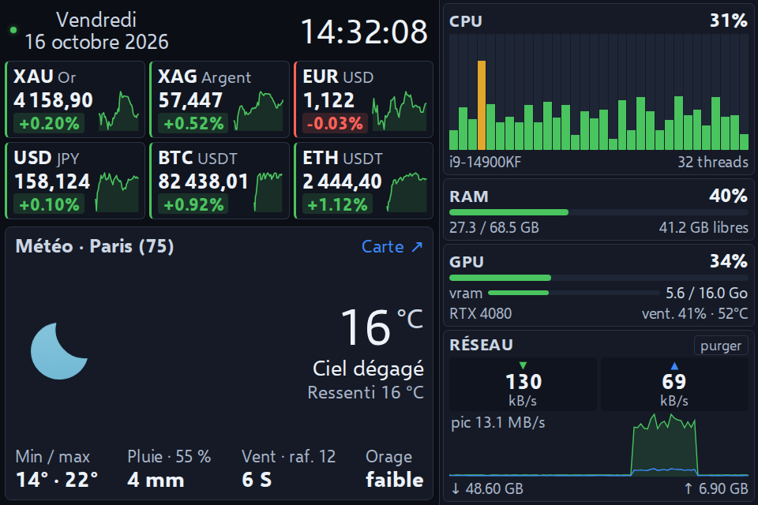
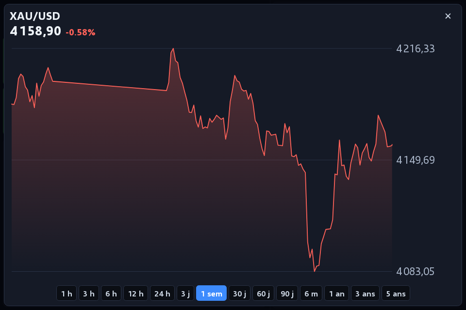
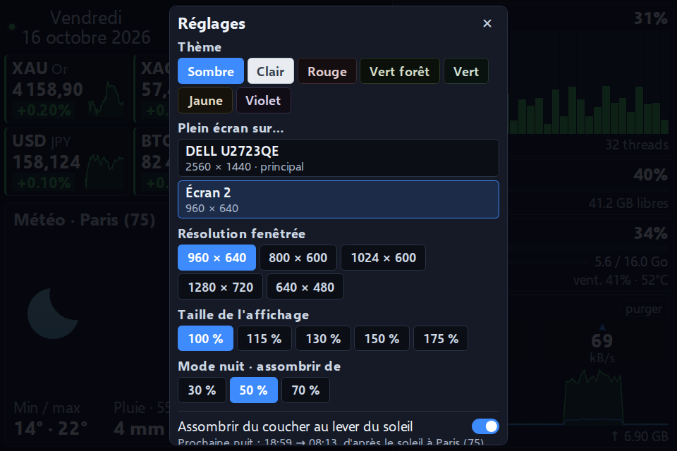

<p align="center">
  
</p>

<h1 align="center">Klakboard</h1>

<p align="center">
  A dashboard for the small screen next to your monitor:<br>
  markets, weather and system load at a glance.
</p>

<p align="center">
  
</p>

---

Klakboard is a frameless desktop app that lives in the notification area and
covers the secondary screen of your choice, above the taskbar. It was designed
for a 3.6-inch 960 × 640 panel (about 325 PPI) and works on any display your
system sees as a monitor; resolution and zoom are adjustable.

> **Status** — Windows 10/11. The interface is in French for now: English is
> next, then layouts for bar and portrait screens, then macOS and Linux (see
> [Roadmap](#roadmap)).

## Features

**Markets** — three badges per row, each with its 24-hour change and a 12-hour
sparkline. A click opens a full-screen chart over 14 periods, from 1 hour to
5 years.

- **Metals**: gold, silver, platinum, palladium, copper
- **Currencies**: any pair among 26 currencies
- **Crypto**: search the whole Binance catalog

When a source stops answering, the badge keeps the last known price, greyed out
after three missed cycles, and the status dot turns red (details in its tooltip).

**Weather** — current conditions and today's forecast for the city you pick:
temperature, feels-like, min/max, rain, wind and gusts, thunderstorm risk
(CAPE). A click opens the Windy map.

**System** — refreshed every second, independently of the markets.

- Load per logical core (green → amber → red bars)
- RAM used / total / available
- NVIDIA GPU: load, VRAM, fan, temperature
- Network: live rates, 90-second history, resettable totals

**Comfort** — 7 muted themes, zoom from 100 to 175 %, night mode (dims the
screen from sunset to sunrise at the weather city), start with Windows.

**Screens** — the screen chosen in the settings is remembered. If it is missing
(not detected yet at login, unplugged), the window waits hidden instead of
covering your main screen, and comes back with it.

<p align="center">
  
  
</p>

### Which screens?

Any screen connected as a display (HDMI, DisplayPort, USB-C or DisplayLink):
small 3.5 to 8-inch panels, a spare monitor, a tablet used as a second screen.
The layout is tuned for landscape screens close to 3:2 or 4:3 (960 × 640,
1024 × 600, 800 × 480…).

Small "sensor panel" screens sold with their own software and driven over a
USB serial link are not displays for the system: Klakboard cannot use them.

## Install

Download `Klakboard.Setup.<version>.exe` from the
[latest release](https://github.com/LokLakh-s/Klakboard/releases/latest) and run it.

The installer is not code-signed, so SmartScreen asks for confirmation on the
first run: *More info* → *Run anyway*. To check a download, compare it with
`SHA256SUMS` in the release, or verify its build provenance with the GitHub CLI:

```bash
gh attestation verify Klakboard.Setup.<version>.exe -R LokLakh-s/Klakboard
```

## Usage

Everything goes through the notification area icon: click to show or hide,
right-click for the menu (add a row, settings, refresh, updates, quit).

| | |
|---|---|
| `Ctrl+Shift+Q` | Quit — **emergency exit**, as the window has no title bar and no taskbar button |
| ✕ on a badge (hover) | Remove the row |
| `Esc` | Close the open panel |

## Updates

Klakboard checks this repository's releases every 30 minutes and shows a
notification; right-click the icon → *Install the update*.

- **Same Electron version**: only the app archive (`app-electron<major>.asar`)
  is downloaded; a small helper swaps it once Klakboard has closed, then
  restarts it. Log: `%TEMP%\klakboard-update.log`.
- **New Electron version**: the archive would not run on the old engine, so
  Klakboard downloads the full installer and runs it.

Every download is checked against the SHA-256 digest published by GitHub.

## Data sources

All free, **no API key**. Requests go out from the main process, with a
10-second timeout.

| Data | Quotes | History |
|---|---|---|
| Metals | [gold-api.com](https://gold-api.com) (spot) | Yahoo Finance, rescaled to the spot price |
| Currencies | Yahoo Finance | Yahoo Finance |
| Crypto | Binance public market data (`data-api.binance.vision`) | Binance |
| Weather | [Open-Meteo](https://open-meteo.com) | — |

- Yahoo quotes metals as **futures** (`GC=F` trades about 1 % above spot). The
  price shown comes from gold-api, and the chart is scaled by
  `spot / last close` so that it ends exactly on that price.
- Yahoo Finance has no official public API: it may change or throttle without
  notice. Klakboard then keeps showing the last known prices.

**Privacy** — no account, no telemetry. The only requests are to the sources
above and to the GitHub API for updates. Settings stay on your computer, in
`%APPDATA%\Klakboard\dashboard.json`.

## Build from source

Requires Node.js 22 or later.

```bash
npm ci
npm test         # unit tests under plain Node, no Electron needed
npm start        # run without packaging
npm run dist     # -> dist/Klakboard Setup <version>.exe (Windows)
```

**Releasing** — bump `version` in `package.json` and push to `main`. The
[Release workflow](.github/workflows/release.yml) runs the tests, builds the
installer and the app archive on GitHub-hosted runners, then creates the
`klakboard-v<version>` tag and release with notes, checksums and a build
provenance attestation.

## Architecture

No npm dependency at runtime and no native module. System metrics come from
built-in tools:

| Metric | Method |
|---|---|
| CPU, RAM | Node `os` module |
| GPU | `nvidia-smi`, every 2 s (retried 30 s after a failure) |
| Network | **one** long-running PowerShell process (spawning one costs ~0.8 s, too slow every second) |

```
main.js       main process: window, screens, tray, IPC, settings, updates
display.js    picks the screen to cover
markets.js    market sources and chart normalisation
weather.js    Open-Meteo weather and icon choice
system.js     CPU / RAM / GPU / network metrics
updates.js    finds and downloads releases
updater.js    swaps the app archive after exit (runs outside the app)
preload.js    IPC bridge (context isolation on)
renderer.js   rendering: badges, charts, settings
style.css     themes and type scale
test/         node:test suites; main.js runs against a fake electron module
```

The page runs under a strict Content Security Policy (no remote content, no
inline script), and API data never goes through `innerHTML`. Settings are
written to a temporary file then renamed, so a power cut cannot leave a
truncated file; an unreadable file is set aside, never overwritten.

## Roadmap

1. English interface (with French kept), settings reachable from the window.
2. Layouts for bar screens (1920 × 480, 2560 × 720) and portrait screens; GPU
   load for AMD and Intel on Windows.
3. macOS and Linux builds.
4. Larger screens: more details, and detailed CPU (per core), GPU and network
   charts on click.

The full review behind this plan, in French: [docs/AUDIT-2026-10-16.md](docs/AUDIT-2026-10-16.md).

## License

[MIT](LICENSE). Weather icons: [Meteocons](https://github.com/basmilius/weather-icons) by Bas Milius (MIT).
