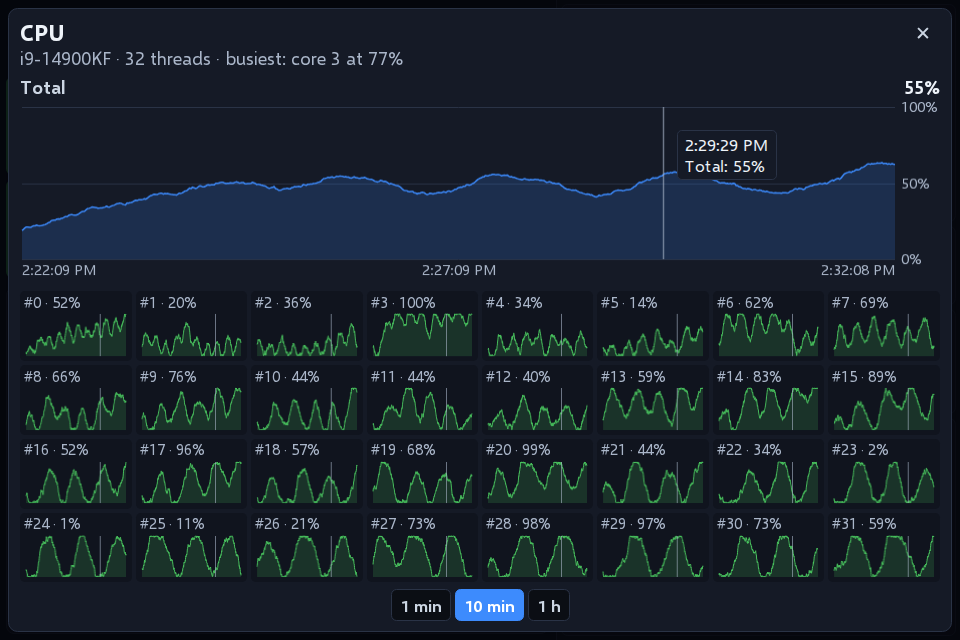
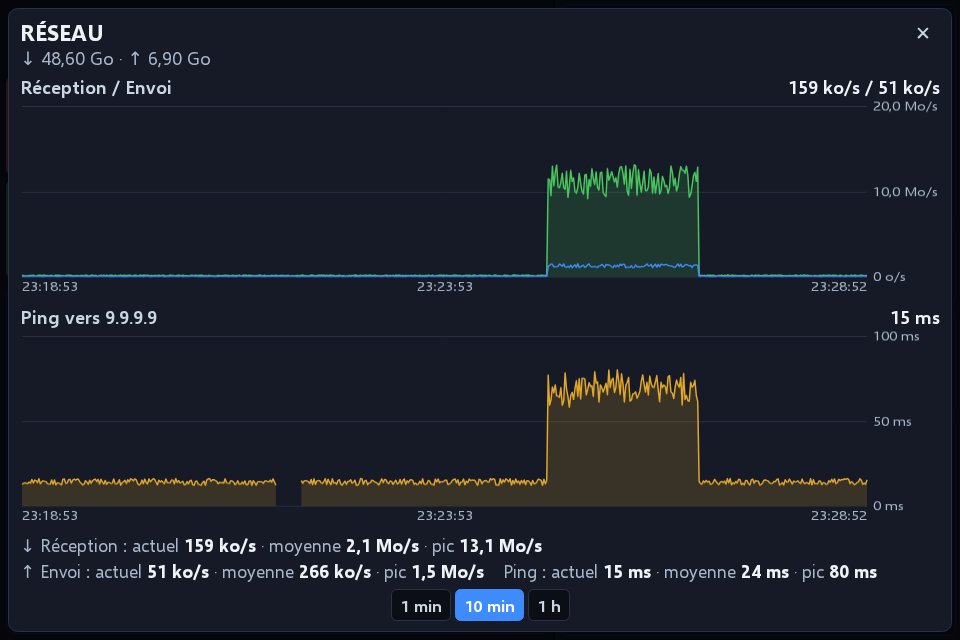
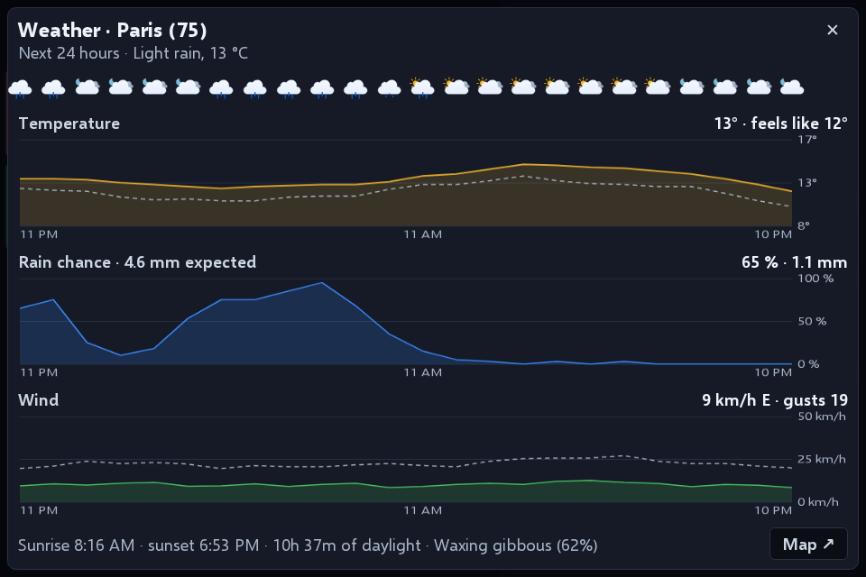
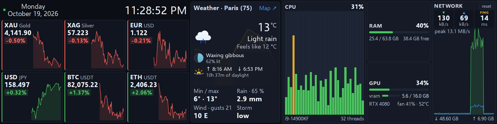
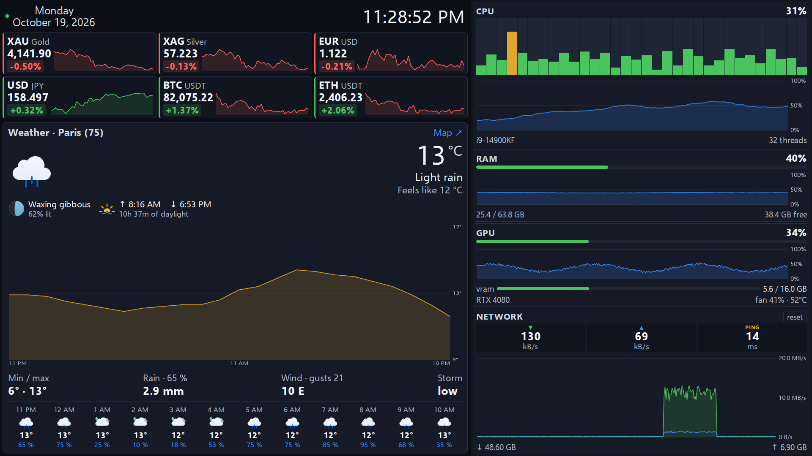
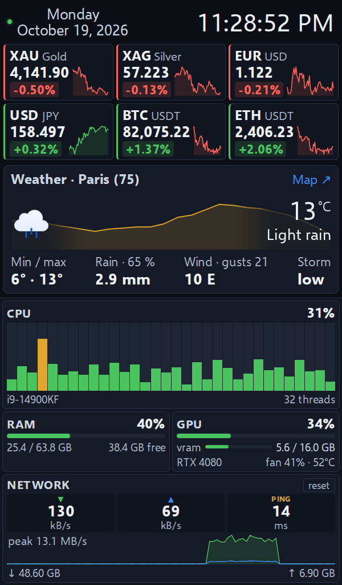
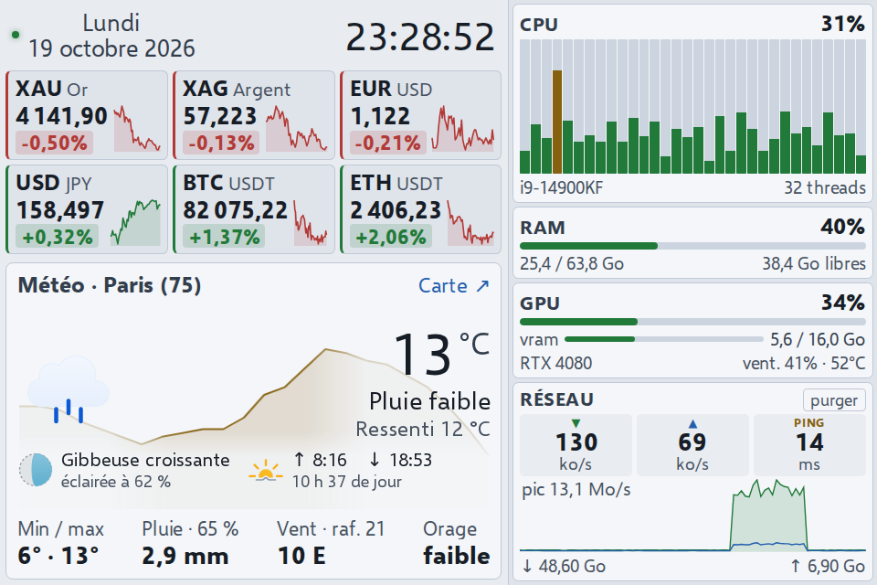

<p align="center">
  
</p>

<h1 align="center">Klakboard</h1>

<p align="center">
  A dashboard for the small screen next to your monitor:<br>
  markets, weather and system load at a glance.
</p>

<p align="center">
  
</p>

---

Klakboard is a frameless desktop app that lives in the notification area and
covers the secondary screen of your choice, above the taskbar. It was designed
for a 3.6-inch 960 × 640 panel (about 325 PPI) and adapts to bar and portrait
screens, and to ordinary monitors with more curves and forecasts; resolution
and zoom are adjustable.

> **Status** — Windows 10/11, macOS 12+ and Linux (x64); interface in English
> and French. The Windows version is the one used daily; macOS and Linux are
> new in 1.8.0, feedback welcome in the issues.

## Features

**Markets** — three badges per row, each with its 24-hour change and a 12-hour
sparkline. A click opens a full-screen chart over 14 periods, from 1 hour to
5 years.

- **Metals**: gold, silver, platinum, palladium, copper
- **Currencies**: any pair among 26 currencies
- **Crypto**: search the whole Binance catalog

When a source stops answering, the badge keeps the last known price, greyed out
after three missed cycles, and the status dot turns red (details in its tooltip).

**Weather** — current conditions and today's forecast for the city you pick:
temperature, feels-like, min/max, rain, wind and gusts, thunderstorm risk
(CAPE). Under the icon, when the card is tall enough: the Moon's phase and how
much of it is lit (computed on your computer, mirrored south of the equator),
sunrise and sunset in the city's time, and the day length. Behind them, a faded
curve shows the next 24 hours; a click on it opens them hour by hour
(temperature and feels-like, rain chance and amount, wind and gusts). The rest
of the card opens the Windy map.

**System** — refreshed every second, independently of the markets.

- Load per logical core (green → amber → red bars)
- RAM used / total / available
- GPU: load, memory, fan and temperature where available (NVIDIA everywhere,
  AMD and Intel on Windows, AMD on Linux, Apple silicon and AMD on macOS)
- Network: live rates, ping to [Quad9](https://quad9.net) (9.9.9.9), 90-second
  history, totals (reset in two clicks)

A click on a system card opens its **history** over 1 minute, 10 minutes or
1 hour, with values under the pointer: CPU total and one curve per core, RAM,
GPU load, memory and temperature, network rates and ping with average and peak.

<p align="center">
  
  
</p>

**Comfort** — English and French (following the system, or picked in the
settings), 7 muted themes, zoom from 100 to 175 %, night mode (dims the screen
from sunset to sunrise at the weather city), start at login.

**Screens** — the screen chosen in the settings is remembered. If it is missing
(not detected yet at login, unplugged), the window waits hidden instead of
covering your main screen, and comes back with it.

<p align="center">
  
  
</p>
<p align="center">
  
</p>

### Which screens?

Any screen connected as a display (HDMI, DisplayPort, USB-C or DisplayLink):
small 3.5 to 8-inch panels, bar screens, a spare monitor, a tablet used as a
second screen. The layout follows the shape of the screen:

- **landscape** panels close to 3:2 or 4:3 (960 × 640, 1024 × 600, 800 × 480…);
- **bar** screens, 2.4:1 and wider (1920 × 480, 1920 × 440, 2560 × 720, 1280 × 400…);
- **portrait** screens, 4:5 and narrower (480 × 800, 600 × 1024, 480 × 1920…);
- **large** screens, from about 1500 × 850: the system cards show their history
  curves, and the weather card the temperature over the next 24 hours and the
  next 12 hours one by one.

<p align="center">
  
</p>
<p align="center">
  
</p>
<p align="center">
  
  
</p>

On first launch Klakboard covers such a secondary screen by itself (960 × 640
first, then the smallest small panel or bar screen); ordinary monitors are only
used when picked in *Full screen on…*.

Small "sensor panel" screens sold with their own software and driven over a
USB serial link are not displays for the system: Klakboard cannot use them.

## Install

From the [latest release](https://github.com/LokLakh-s/Klakboard/releases/latest):

| System | File | First launch |
|---|---|---|
| Windows 10/11 | `Klakboard.Setup.<version>.exe` | Not code-signed: SmartScreen asks for confirmation (*More info* → *Run anyway*) |
| macOS 12+, Apple silicon | `Klakboard-<version>-arm64.dmg` | Not notarized: *System Settings* → *Privacy & Security* → *Open Anyway* |
| macOS 12+, Intel | `Klakboard-<version>-x64.dmg` | Same as above |
| Linux x64 | `Klakboard-<version>-x86_64.AppImage` (make it executable) or `Klakboard-<version>-amd64.deb` | — |

On Linux, Klakboard runs under XWayland: native Wayland does not let an app
place its window on a given screen nor keep it on top. GNOME only shows the
tray icon with the AppIndicator extension; without it, the menu still opens
with a right click in the dashboard.

To check a download, compare it with `SHA256SUMS` in the release, or verify its
build provenance with the GitHub CLI:

```bash
gh attestation verify Klakboard.Setup.<version>.exe -R LokLakh-s/Klakboard
```

## Usage

Click the notification area icon to show or hide the dashboard. The menu (add
a row, settings, refresh, updates, quit) opens with a right click on that icon,
a right click anywhere in the dashboard (long press on a touch screen), or the
⋮ button that appears when hovering the top bar.

| | |
|---|---|
| `Ctrl+Shift+Q` (`Ctrl+Option+Q` on macOS) | Quit — **emergency exit**, as the window has no title bar and no taskbar button |
| ✕ on a badge (hover) | Remove the row |
| `Esc` | Close the open panel |

## Updates

Klakboard checks this repository's releases every 30 minutes and shows a
notification; right-click the icon → *Install the update*.

On **Windows** it installs the update itself:

- **Same Electron version**: only the app archive (`app-electron<major>.asar`)
  is downloaded; a small helper swaps it once Klakboard has closed, then
  restarts it. Log: `%TEMP%\klakboard-update.log`.
- **New Electron version**: the archive would not run on the old engine, so
  Klakboard downloads the full installer and runs it.

Every download is checked against the SHA-256 digest published by GitHub.

On **macOS and Linux** it opens the release page: a signed app bundle, a
read-only AppImage or a system package cannot be patched in place.

## Data sources

All free, **no API key**. Requests go out from the main process, with a
10-second timeout.

| Data | Quotes | History |
|---|---|---|
| Metals | [gold-api.com](https://gold-api.com) (spot) | Yahoo Finance, rescaled to the spot price |
| Currencies | Yahoo Finance | Yahoo Finance |
| Crypto | Binance public market data (`data-api.binance.vision`) | Binance |
| Weather | [Open-Meteo](https://open-meteo.com) | — |
| Ping | ICMP echo to Quad9 (9.9.9.9) with the system's `ping`, once a second | kept 1 hour, like the other metrics |

- Yahoo quotes metals as **futures** (`GC=F` trades about 1 % above spot). The
  price shown comes from gold-api, and the chart is scaled by
  `spot / last close` so that it ends exactly on that price.
- Yahoo Finance has no official public API: it may change or throttle without
  notice. Klakboard then keeps showing the last known prices.

**Privacy** — no account, no telemetry. The only network traffic is to the
sources above (the ping included) and to the GitHub API for updates. Settings stay on your computer, in
`dashboard.json`: `%APPDATA%\Klakboard` on Windows, `~/Library/Application
Support/Klakboard` on macOS, `~/.config/Klakboard` on Linux.

## Build from source

Requires Node.js 22 or later.

```bash
npm ci
npm test         # unit tests under plain Node, no Electron needed
npm start        # run without packaging
npm run dist     # packages for the current system, in dist/
```

**Continuous integration** — every push and pull request runs the tests on
Windows, macOS and Linux, including a smoke test that reads the real system
metrics of each one; pull requests also build the packages of the three systems.

**Releasing** — bump `version` in `package.json` and push to `main`. The
[Release workflow](.github/workflows/release.yml) runs the tests, builds the
Windows, macOS and Linux packages on GitHub-hosted runners, then creates the
`klakboard-v<version>` tag and release with notes, checksums and a build
provenance attestation.

## Architecture

No npm dependency at runtime and no native module. System metrics come from
built-in tools, through one long-running process wherever spawning one each
second would cost too much (PowerShell takes ~0.8 s to start):

| Metric | Windows | macOS | Linux |
|---|---|---|---|
| CPU | Node `os` | Node `os` | Node `os` |
| RAM | Node `os` | `vm_stat` (`os.freemem()` only counts free pages) | Node `os` |
| GPU, NVIDIA | `nvidia-smi -lms`, one process | — | `nvidia-smi -lms`, one process |
| GPU, others | performance counters (CIM), one PowerShell process | `ioreg` (IOAccelerator) | amdgpu sysfs |
| Network | `Get-NetAdapterStatistics`, one PowerShell process | `netstat -ibn` | `/proc/net/dev` |
| Ping | `ping.exe`, one process (any Windows language) | `ping`, one process | `ping`, one process |

```
main.js       main process: window, screens, tray, IPC, settings, updates
display.js    picks the screen to cover
markets.js    market sources and chart normalisation
weather.js    Open-Meteo weather and icon choice
astro.js      Moon phase, computed from the date (Meeus), shared by page and tests
system.js     CPU / RAM / GPU / network metrics, sampled every second
history.js    metrics history: 10 min at 1 s, 1 h at 10 s (main process)
platform/     metric sources per system (win32, darwin, linux, nvidia, ping)
autostart.js  start at login on Linux (XDG autostart entry)
updates.js    finds and downloads releases
updater.js    swaps the app archive after exit (runs outside the app)
preload.js    IPC bridge (context isolation on)
renderer.js   rendering: badges, charts, history views, settings
charts.js     time-series charts on canvas
i18n.js       interface strings (English, French), shared by main and page
style.css     themes, type scale, landscape / bar / portrait layouts
fonts/        Selawik (Segoe UI metrics) for systems without Segoe UI
test/         node:test suites; main.js runs against a fake electron module
```

The page runs under a strict Content Security Policy (no remote content, no
inline script), and API data never goes through `innerHTML`. Settings are
written to a temporary file then renamed, so a power cut cannot leave a
truncated file; an unreadable file is set aside, never overwritten.

## Roadmap

1. ~~Public release~~ (1.6.0), ~~English and French, menu inside the window,
   bar and portrait layouts~~ (1.7.0), ~~macOS and Linux, GPU load for AMD and
   Intel~~ (1.8.0), ~~history views and large screens~~ (1.9.0).
2. Next ideas are welcome in the issues.

The full review behind this plan, in French: [docs/AUDIT-2026-10-16.md](docs/AUDIT-2026-10-16.md).

## License

[MIT](LICENSE). Weather icons: [Meteocons](https://github.com/basmilius/weather-icons) by Bas Milius (MIT).
Font: [Selawik](https://github.com/microsoft/Selawik) by Microsoft (SIL Open Font License).
